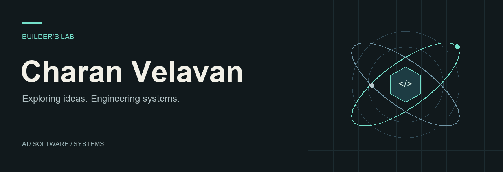

  <a href="https://charanvelavan.github.io/CharanVelavan/">
    <picture>
      <source media="(prefers-reduced-motion: reduce)" srcset="assets/builders-lab.svg" />
      
    </picture>
  </a>

  <a href="https://charanvelavan.github.io/CharanVelavan/"><strong>Enter the interactive lab ↗</strong></a> &nbsp; / &nbsp;
  <a href="#selected-work">Selected work</a> &nbsp; / &nbsp;
  <a href="#on-the-workbench">On the workbench</a> &nbsp; / &nbsp;
  <a href="https://github.com/CharanVelavan?tab=repositories">All repositories</a>

## Hey, I’m Charan.

I build across **AI, software, and systems**—from computer vision experiments to tools for understanding complex infrastructure. I like turning an idea into something you can run, inspect, and improve.

This is my builder’s lab: a collection of projects, experiments, and things learned along the way.

## Selected work

### ORCA-NTN · Cyber-aware network coordination

Agent-assisted incident investigation and guarded recovery for an **emulated satellite-backed network**. Built with Team SolarSailor for the ITU AI for Good Sandbox Hackathon UAE.

`AI agents` `Network resilience` `Policy & audit`

[Explore the code →](https://github.com/CharanVelavan/ORCA) &nbsp; · &nbsp; [Watch the recorded demo →](https://orca-ntn.vercel.app)

The hosted showcase replays recorded scenarios; fresh inference runs through the local implementation.

### SurgeSight · From cyclone bulletin to infrastructure insight

A prototype that screens infrastructure exposure, explores changes to a cyclone track, and drafts multilingual department advisories with human approval. Built with Team Echo for Code for Communities 2.0.

`Geospatial AI` `Gemini` `React` `FastAPI` `Google Cloud`

[Explore the project →](https://github.com/CharanVelavan/SurgeSight) &nbsp; · &nbsp; [Watch the walkthrough →](https://youtu.be/BeFNW2ZWFQM)

Experimental exposure screening for prioritisation; it does not replace official forecasts.

### Bird’s AI · Computer vision experiments

An early computer vision project with sample input and output videos, training results, and evaluation plots. A look at the experiments behind the output.

`Computer vision` `Model evaluation` `Video`

[Explore the project →](https://github.com/CharanVelavan/Bird-s-AI) &nbsp; · &nbsp; [See a sample output →](https://github.com/CharanVelavan/Bird-s-AI/blob/main/5_output.mp4)

## On the workbench

Three threads running through my projects:

- **AI that works with evidence** — tool use, grounded answers, and decisions people can review.
- **Systems you can investigate** — networking, infrastructure, and the behaviour underneath the interface.
- **Interfaces that make complexity usable** — clear views, useful controls, and a path from experiment to demo.

## Tools in the lab

| Area | Tools used across the featured projects |
| :--- | :--- |
| AI & data | Python · Gemini · retrieval · computer vision |
| Applications | React · FastAPI |
| Infrastructure | Google Cloud · Cloud Run · Git · GitHub |

---

  <strong>Have a project in mind? Let’s build something interesting.</strong> 
  <a href="https://github.com/CharanVelavan?tab=repositories">Explore my repositories</a>
  &nbsp; · &nbsp;
  <a href="https://github.com/CharanVelavan/CharanVelavan/issues">Start a conversation</a>

